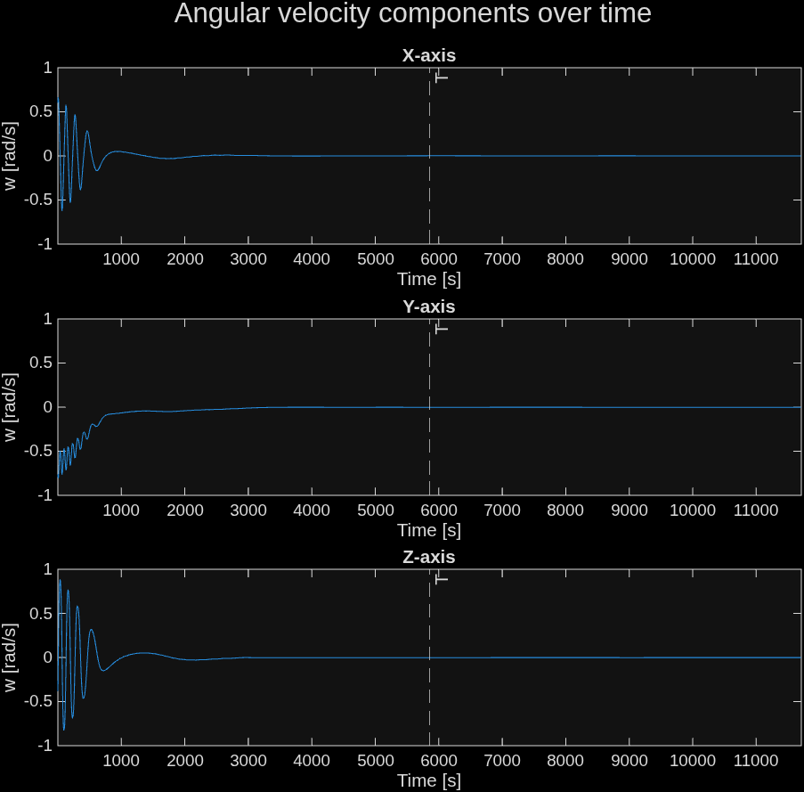

# Magnetic Satellite Detumbling Simulation
My Aerospace Simulation Research project
supervised by Zac Isaac from [@RocketWerkz](https://github.com/RocketWerkz).

## Detumble example
  
...for a satellite paramterised by:  

```
semi_major = 7021e3; % Meters
inclination = deg2rad(65); % Radians

angular_velocity = [0.604 -0.760 -0.384];
inertia_tensor   = diag([0.33 0.37 0.35]);
attitude = [-0.062 0.925 -0.007 0.375];
```

## Project presentation
[presentation_README.pdf](presentation_README.pdf)

## References
- Avanzini, G., & Giulietti, F. (2012). [Magnetic detumbling of a rigid spacecraft](https://doi.org/10.2514/1.53074). *Journal of Guidance, Control, and Dynamics*, 35(4), 1326–1334.
- Markley, F. L., & Crassidis, J. L. (2014). [*Fundamentals of Spacecraft Attitude Determination and Control*](https://doi.org/10.1007/978-1-4939-0802-8). Springer, Space Technology Library.
